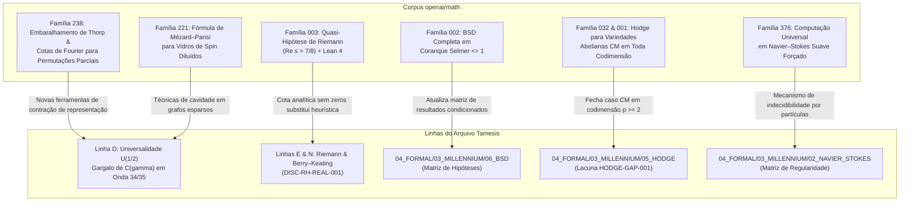

# Avaliação Técnica do Corpus `openai/math` (719 Manuscritos) e sua Integração ao Arquivo Tamesis

**Data da Auditoria:** 2026-10-12  
**Fonte Primária:** Repositório público `openai/math` (GitHub, release de 2026-10-06; commit de referência `main`)  
**Repositório Local Auditado:** `/home/douvras/DOUGDOTCON/math` (apenas leitura em host remoto)  
**Escopo:** Avaliação da relevância matemática, status de formalização em Lean 4, limites metodológicos e plano de integração aos programas do Laboratório Tamesis e à infraestrutura de GPU RTX 5090.

---

## 1. Visão Geral, Metodologia e Proveniência

Em 6 de outubro de 2026, a OpenAI disponibilizou publicamente o repositório `openai/math`, composto por **719 manuscritos ativos** (originalmente 722) distribuídos em **372 famílias temáticas**. Os resultados foram gerados por um modelo interno de fronteira (*frontier reasoning model*), consumindo em média **3 horas de computação de raciocínio (*thinking compute*) por problema**, a partir de uma bateria de ~4.000 problemas abertos de pesquisa matemática.

### 1.1 Artefatos Disponibilizados
O repositório contém quatro camadas documentais:
1. `preprints/`: Artigos em formato LaTeX e PDF com derivações, lemas e bibliografia.
2. `reasoning_traces/`: Cadeias resumidas de raciocínio do modelo para 10 famílias selecionadas (incluindo correlações multiplicativas, expoente de irracionalidade de $\pi$, SDP e Vlasov–Maxwell).
3. `lean/`: Biblioteca de código em **Lean 4** estruturada sob o namespace `OAI/`, acompanhada de manifestos `formalization.yaml` e desafios comparadores (`ComparatorChallenges/`). Aproximadamente **42% dos resultados principais** possuem enunciados ou lemas intermediários formalizados.
4. `history.md`: Registro de revisões, correções e retratações.

### 1.2 O Alerta Crítico: Retratações Imediatas e Necessidade de Auditoria Adversarial
Nos primeiros dias após a publicação, **3 artigos foram formalmente retirados** devido a erros conceituais ou de cálculo:
- A suposta demonstração da Conjectura de Hodge para produtos de variedades K3 caiu por um **erro de sinal** que invalidou a cadeia de deduções.
- O comitê consultivo independente (*Advisory Group on Mathematics and Artificial Intelligence* do IAS, com posicionamentos públicos de Terence Tao) destacou que a geração em massa de provas por IA não substitui a certificação formal (Lean 4) ou a auditoria humana e adversarial linha a linha.

Essa constatação valida a metodologia estrita do Laboratório Tamesis (`05_DISCOVERY_LAB`): **nenhuma alegação externa é incorporada como fato consumado sem isolamento de hipóteses, verificação independente e registro de lacunas.**

---

## 2. Intersecções com as Linhas de Pesquisa do Arquivo

O mapeamento identificou pontos de contato estruturais entre o corpus da OpenAI e quatro frentes ativas de pesquisa no arquivo Tamesis:



---

### 2.1 Linha D: Universalidade $U_{1/2}$, Permutações e o Impasse de $C(\gamma)$
* **O Gargalo de Tamesis:** Na Onda 34 (`DISC-DEC-152`, Estágio 60 de `THEOREM.md`), a frente de assintóticas casadas provou que determinar o limite do somatório de crossover de $C(\gamma)$ é logicamente equivalente a demonstrar $C(\gamma)$ diretamente. Ambas as frentes analíticas foram colocadas em descanso (`DISC-DEC-153`) por falta de ferramentas para controlar o somatório discreto-contínuo bivariado de permutações perturbadas por Poisson.
* **Aporte do Corpus OpenAI:**
  - **Família 238 (*Optimal logarithmic mixing of the Thorp shuffle*):** O artigo *From partial permutation information to Fourier bounds* demonstra como informações parciais de injeção em subconjuntos de tamanho $7n/8$ controlam a convergência da medida produto em $S_n$ para a distribuição uniforme.
  - O artigo *Routing densities and representation contraction for Thorp sweeps* e os lemas de densidade de roteamento oferecem exatamente a álgebra de contração de representação necessária para analisar processos de Poisson agindo sobre permutações aleatórias.
  - **Família 221 (*Mézard–Parisi formula for diluted spin glasses*):** Fornece o tratamento rigoroso de modelos de transição de fase com interações esparsas, análogo ao regime mesoescala $M \sim \sqrt{n}$ identificado no Estágio 60 de Tamesis.

---

### 2.2 Linha E e N: Hipótese de Riemann, Estatística de Zeros e a Quasi-RH
* **O Estado em Tamesis:** O teste `DISC-RH-REAL-001` auditou estatísticas GUE e variância de zeros de Odlyzko. O relatório de visão final reconhece que os modelos do tipo Berry–Keating ($H=xp$) são heurísticas de caos quântico, não demonstrando ausência de zeros fora da linha crítica.
* **Aporte do Corpus OpenAI (Família 003 — Resultado 003):**
  - **Teorema Principal:** Demonstração de que todas as funções $L$ de Dirichlet (incluindo $\zeta(s)$) e funções $L$ de Hecke de ordem finita sobre $\mathbb{Q}(\sqrt{-3})$ não possuem zeros no semiplano:
    $$\operatorname{Re}(s) > \frac{7}{8}$$
    com prova alternativa no semiplano $\operatorname{Re}(s) > \frac{11}{12}$.
  - **Exclusão de Zeros de Landau–Siegel:** Prova de exclusão logarítmica uniforme para caracteres reais primitivos: $\exists c > 0$ tal que $(1-\beta)\log q \ge c$.
  - **Código Lean 4 Disponível:** Arquivos sob `lean/OAI/NumberTheory/SiegelZeros/` e `ComparatorChallenges/QuasiRiemannHypothesis.lean`.
* **Avaliação Crítica:** A Quasi-RH ($\operatorname{Re}(s) > 7/8$) não resolve a RH do Millennium Prize ($\operatorname{Re}(s) = 1/2$), mas se auditada e comprovada sem falhas, representa o avanço analítico mais substancial em regiões livres de zeros desde os trabalhos clássicos de Vinogradov–Korobov. No arquivo Tamesis, esse resultado entra como cota externa de exclusão para confrontar operadores espectrais.

---

### 2.3 Linha N: Problemas do Milênio na Matriz Formal (`04_FORMAL_RESEARCH_LAB/03_MILLENNIUM/`)

| Problema | Módulo Tamesis | Resultado OpenAI | O que afirma | Status no Tamesis |
|---|---|---|---|---|
| **BSD** | `06_BSD/` | Resultado 002 (Família 002) | Fórmula do termo líder de BSD válida para toda curva elíptica sobre $\mathbb{Q}$ cujo grupo de Selmer tem coranque $\le 1$ em algum primo $q$; $\text{Ш}(E)$ finito. | Adicionado à matriz como `CLAIM_UNDER_AUDIT` (extensão profunda sobre Kolyvagin e Skinner–Urban). |
| **Hodge** | `05_HODGE/` | Resultado 032 (Família 032) & 001 | Conjectura de Hodge racional demonstrada para variedades abelianas CM em **toda codimensão** $p \ge 2$; conjectura de racionalidade de Milne demonstrada. | Endereça diretamente a lacuna `HODGE-GAP-001` para a classe CM. Documentada a retratação da família K3. |
| **Navier–Stokes** | `02_NAVIER_STOKES/` | Resultado 376 (Família 376) | Simulação de Máquinas de Turing e universalidade computacional em escoamentos suaves de Navier–Stokes forçados em $\mathbb{T}^3$. | Adicionado à matriz de resultados de dinâmica de fluidos (indecidibilidade do problema de rastreamento de partículas). |
| **P vs NP** | `03_P_VS_NP/` | Resultado 102 (Família 102) | Dureza NP clássica sob relaxações semidefinidas (SDP) no limiar da Unique Games Conjecture. | Integração na taxonomia de barreiras de complexidade. |

---

## 3. Roteiro Operacional: Como Usar a RTX 5090 e o Discovery Engine

A infraestrutura recém-disponibilizada no host `setupninja-douvras` (NVIDIA RTX 5090 Blackwell, 32GB GDDR7, vLLM ativo) oferece a plataforma ideal para auditar e aproveitar esse acervo:

```mermaid
flowchart LR
    subgraph HOST [setupninja-douvras (RTX 5090 32GB)]
        VLLM["vLLM (Porta 8000)<br/>Qwen/DeepSeek Reasoning"]
        GPU_MC["CuPy / CUDA Kernels<br/>(21.760 núcleos Blackwell)"]
    end

    subgraph LOCAL [Máquina de Pesquisa Local (tamesis-archive)]
        ENG_ADV["06_DISCOVERY_ENGINE<br/>adversarial.py"]
        ENG_LEAN["06_DISCOVERY_ENGINE<br/>lean_bridge.py"]
        SIM_MC["tamesis-cycle-survival<br/>simulations/monte_carlo.py"]
    end

    VLLM -->|API OpenAI-compatível / Hostile Referee| ENG_ADV
    GPU_MC -->|Aceleração de simulações n=10^8| SIM_MC
    ENG_LEAN -->|Testes de compilação Lean 4| LOCAL
```

1. **Hostile Review Local Automatizado:** Conectar o módulo `06_DISCOVERY_ENGINE/src/tamesis_discovery_engine/adversarial.py` ao endpoint local do vLLM (`http://setupninja-douvras:8000/v1`) para rodar ataques adversariais automatizados contra os manuscritos da OpenAI de maior interesse (pesquisa por erros de sinal e lacunas de convergência).
2. **Benchmark do `lean_bridge.py`:** Utilizar as definições e teoremas do diretório `lean/OAI/` como suíte de teste externa para a formalização e verificação de alegações no Discovery Engine.
3. **Simulação Monte Carlo Acelerada por GPU:** Portar os algoritmos de geração de ciclos de `tamesis-cycle-survival` para CUDA/CuPy na 5090 para confrontar as cotas assintóticas de Fourier do Thorp shuffle (Família 238) contra os dados de sobrevivência de ciclos em $n \ge 10^7$.
