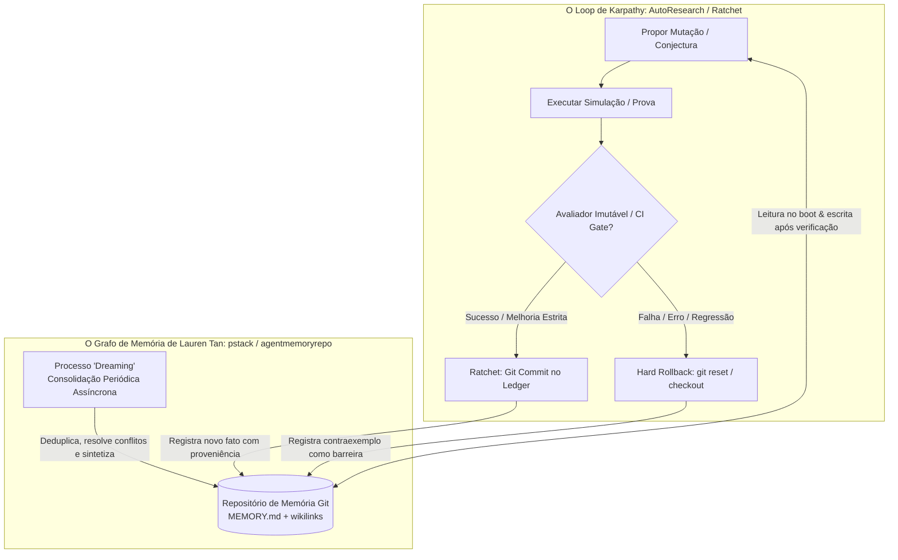

# Arquitetura de Pesquisa Autônoma 24/7: Síntese Karpathy–Tan sobre a RTX 5090

**Data:** 2026-10-12  
**Autores/Inspirações:** Andrej Karpathy (*AutoResearch / The Ratchet Loop*), Lauren Tan / @poteto (*Loops You Can Trust / pstack / Agent Memory Repo*) e a infraestrutura do *Tamesis Discovery Lab*.  
**Objetivo:** Operar pesquisa matemática e computacional contínua 24/7 com **custo zero de tokens de API**, unindo modelos locais na GPU RTX 5090 (32GB GDDR7) a loops de avanço e consolidação de memória.

---

## 1. Os Dois Pilares da Pesquisa Autônoma Contínua

Para manter agentes de IA pesquisando sem supervisão humana contínua sem que ocorra alucinação progressiva (*context drift*), degradação de contexto ou loop infinito de erros, é necessária a união de dois paradigmas complementares:



### 1.1 O Loop de Karpathy (O Padrão *Ratchet* de 5 Minutos)
Demonstrado por Andrej Karpathy ao rodar 700 experimentos autônomos de machine learning em 2 dias em uma única GPU:
1. **O Avaliador Imutável (`eval.py`):** O agente tem permissão total de mutar hipóteses, conjecturas e código de cálculo (`program.py`), mas **jamais pode modificar o arquivo de avaliação ou o critério de falsificação**. O juiz é estático e rigoroso.
2. **O Mecanismo da Catraca (*Ratchet*):** Cada ciclo formula uma mudança atômica. Se e somente se o teste passar sem erros e a métrica pré-registrada avançar estritamente, a mudança é aceita e comitada no git.
3. **Hard Rollback Imediato:** Qualquer falha de sintaxe, divergência numérica ou violação de hipótese resulta em reversão imediata (`git checkout`), retornando o estado ao último ponto seguro antes do próximo ciclo.

### 1.2 O Grafo de Memória de Lauren Tan (@poteto — SpaceX AI / *pstack*)
Demonstrado na entrega contínua de mais de 1.000 PRs verificados por mês via agentes em paralelo:
1. **Chief of Staff Pattern:** Um meta-agente gerencia a fila de hipóteses abertas e despacha agentes atômicos e especializados para fatias delimitadas.
2. **Grafo de Memória Baseado em Git (`agentmemoryrepo`):**
   - A memória não fica solta no prompt; vive em um repositório git estruturado com `MEMORY.md` como índice central.
   - Entradas no formato: `- [Afirmação verificada] [source: commit_hash; added: YYYY-MM-DD]`.
   - Conexões semânticas via wikilinks: `[[u12_crossover]]`, `[[thorp_fourier]]`, `[[riemann_zeros]]`.
3. **O Ciclo de "Dreaming" (Sonho / Consolidação):**
   - Um agente periódico e assíncrono que "acorda" a cada N ciclos para:
     * Identificar padrões recorrentes entre sessões e criar novas sínteses.
     * Deduplicar notas redundantes.
     * Resolver contradições e arquivar hipóteses refutadas.

---

## 2. Modelos Recomendados para Execução Local 24/7 na RTX 5090

A máquina `setupninja-douvras` possui **32 GB de VRAM GDDR7**, processador de 24 núcleos Intel Core Ultra 9 285K e 3.2 TB de armazenamento NVMe livre.

Atualmente, o vLLM já opera na porta 8000 rodando `Qwen/Qwen3-14B-AWQ` (~12 GB de VRAM, restando ~20 GB livres). Para maximizar o raciocínio matemático e a economia de tokens, o catálogo recomendado para a 5090 inclui:

| Modelo | Tamanho / Quantização | VRAM Alocada | Função no Loop 24/7 |
|---|---|---|---|
| **DeepSeek-R1-Distill-Qwen-32B** | AWQ / FP8 / GPTQ 4-bit | ~20–22 GB | **Árbitro Hostil e Dedução Matemática:** Capacidade de raciocínio de alta profundidade para auditar preprints, caçar erros de sinal e propor lemas. |
| **Qwen2.5-Coder-32B-Instruct** | AWQ / FP8 | ~20–22 GB | **Engenheiro de Código e Lean 4:** Automação de testes em Python, SymPy, geração de scripts de simulação e compilação de provas em Lean. |
| **Qwen2.5-Math-32B-Instruct** | AWQ | ~20–22 GB | **Álgebra Simbólica e Assintóticas:** Especializado em somatórios bivariados, séries assintóticas e teoria analítica dos números. |
| **Qwen/Qwen3-14B-AWQ** (Atual) | AWQ 4-bit | ~12 GB | **Worker Rápido e Fuzzing:** Leitura rápida, extração de texto em lote dos preprints e filtragem preliminar. |

---

## 3. Protocolo de Implantação e Operação 24/7

### 3.1 O Loop Autônomo de Pesquisa
O script de pesquisa contínua orquestra o ciclo sem interação humana:

```python
# Pseudocódigo do Loop de Pesquisa Contínua Tamesis (24/7)
while True:
    # 1. Boot: Carregar Grafo de Memória
    memory = load_agent_memory("agent_memory/MEMORY.md")
    
    # 2. Chief of Staff: Selecionar Próxima Hipótese da Fila
    task = select_pending_claim("05_DISCOVERY_LAB/01_PORTFOLIO/TEST_QUEUE.yaml")
    
    # 3. Proposta (vLLM Local - Zero Token Cost)
    candidate_code = local_llm.generate_step(task, memory)
    apply_code(candidate_code)
    
    # 4. Avaliador Imutável (Ratchet Gate)
    result = run_immutable_test_suite(task)
    
    if result.is_strictly_better():
        # Sucesso: Comita e Avança Catraca
        git_commit(f"discovery: avanço validado em {task.id}")
        update_memory(task, result)
    else:
        # Falha: Rollback imediato sem contaminação
        git_reset_hard()
        record_negative_finding(task, result)
        
    # 5. Dreaming Loop (a cada 10 ciclos)
    if cycle_count % 10 == 0:
        run_dreaming_consolidation()
```

### 3.2 Isolamento de Segurança no Servidor Ninja
Para não interferir nos agentes e containers já ativos no servidor (`SETUP_LAB` e containers Docker):
- O ambiente de pesquisa opera exclusivamente dentro do caminho de trabalho do usuário ou em containers dedicados com mapeamento isolado de portas.
- O vLLM já ativo na porta 8000 expõe a API padrão compatível com OpenAI (`http://localhost:8000/v1`), permitindo consumo transparente sem scripts intrusivos.
