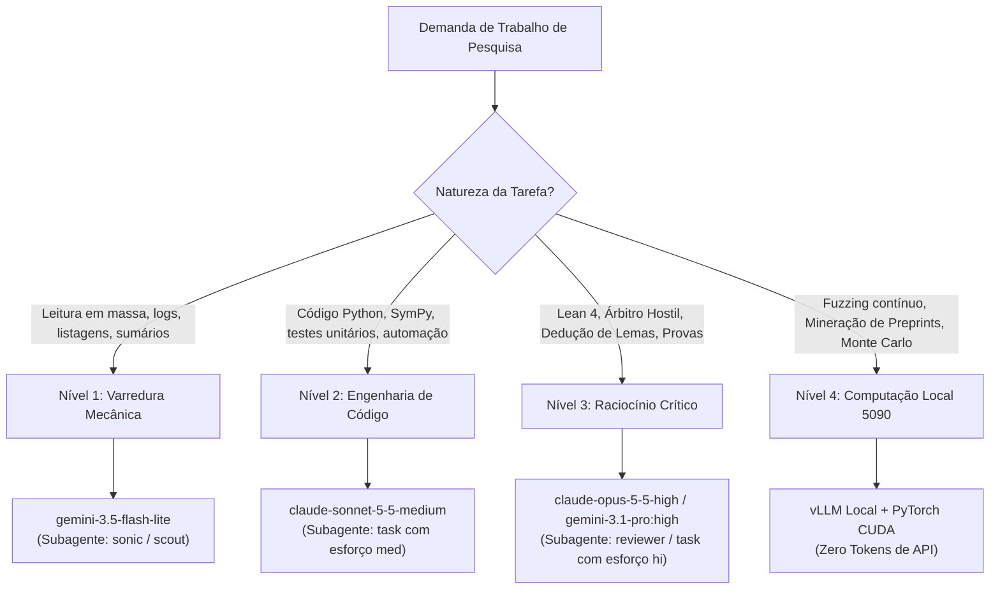

# Matriz de Alocação e Especialização de Modelos (Antigravity API & Nó Local)

**Data de Vigência:** 2026-10-12  
**Objetivo:** Otimização estrita de consumo de tokens, latência e custo computacional através da delegação de tarefas aos modelos corretos disponíveis na API `google-antigravity` e no nó local com GPU RTX 5090 (`setupninja-douvras`).

---

## 1. Inventário de Recursos Disponíveis

### 1.1 API Antigravity (`google-antigravity`)
* **Nível Flash / Ultraleve:**
  - `google-antigravity/gemini-3.5-flash-lite` (Contexto: 1M, saída: 66K, ultra-econômico)
  - `google-antigravity/gemini-3.8-flash` / `gemini-3.7-flash` (Contexto: 1M, alta velocidade)
* **Nível Pro / Raciocínio Geral:**
  - `google-antigravity/gemini-3.1-pro` / `gemini-3.1-pro:high` (Contexto: 1M, profundidade analítica)
* **Nível Sonnet / Engenharia e Sintaxe Exata:**
  - `google-antigravity/claude-sonnet-5-5-medium` / `claude-sonnet-5-5-high` (Contexto: 1M, saída: 128K, precisão extrema em código e Lean 4)
  - `google-antigravity/claude-sonnet-4-6` (Contexto: 250K)
* **Nível Opus / Árbitro de Elite e Dedução Matemática Profunda:**
  - `google-antigravity/claude-opus-5-5-high` (Contexto: 1M, saída: 128K, raciocínio lógico-matemático formal máximo)
  - `google-antigravity/claude-opus-4-6` (Contexto: 250K)
* **Modelos Abertos:**
  - `google-antigravity/gpt-oss-120b` (Contexto: 131K)

### 1.2 Nó Local com GPU Dedicada (`setupninja-douvras`)
* **Hardware:** Intel Core Ultra 9 285K (24 cores), 64GB RAM, 3.2TB NVMe, NVIDIA RTX 5090 Blackwell (32GB GDDR7, 21.760 CUDA cores).
* **Serviço de LLM Local:** `vLLM` na porta `8000` (`http://45.170.145.192:8000/v1` ou via túnel SSH `http://localhost:8000/v1`), atualmente com `Qwen/Qwen3-14B-AWQ` (expansível para `DeepSeek-R1-Distill-32B` ou `Qwen2.5-32B`).
* **Custo de Token:** **Zero** (consumo puramente de energia elétrica local, sem limites de taxa ou cota).

---

## 2. Matriz de Distribuição de Tarefas por Nível

| Nível | Tipo de Tarefa | Modelo Recomendado | Subagente / Config OMP | Justificativa de Economia |
|---|---|---|---|---|
| **Tier 1: Varredura e Extração** | Leitura de logs extensos, varredura de diretórios, extração de tabelas, pré-filtragem de preprints, sumarização preliminar | `google-antigravity/gemini-3.5-flash-lite` | `sonic` ou `scout` (`model: "@smol"`) | Evita queimar tokens de raciocínio caro (Pro/Opus) lendo texto bruto não lapidado; aproveita a janela de 1M com custo insignificante. |
| **Tier 2: Engenharia e Pipeline** | Implementação de módulos no `06_DISCOVERY_ENGINE`, conversão LaTeX $\to$ SymPy, testes do pytest, scripts de download e manipulação de JSON/YAML | `google-antigravity/claude-sonnet-5-5-medium` | `task` (`model: "google-antigravity/claude-sonnet-5-5-medium"`, `effort: "med"`) | Oferece a melhor relação custo/qualidade sintática de código do mercado sem a latência ou o custo do Opus. |
| **Tier 3: Dedução e Árbitro Adversarial** | Atuar como árbitro hostil (*Hostile Referee*) no `05_DISCOVERY_LAB`, caçar erros de sinal ou saltos de convergência, formalizar provas em Lean 4, auditar assintóticas | `google-antigravity/claude-opus-5-5-high` ou `gemini-3.1-pro:high` | `reviewer` ou `task` (`model: "google-antigravity/claude-opus-5-5-high"`, `effort: "hi"`) | **Nunca** deve receber prompts sujos com código irrelevante. Deve ser chamado apenas com o extrato matemático essencial (<15K tokens) para focar poder analítico. |
| **Tier 4: Processamento Contínuo e Simulação** | Mineração sem fim de preprints, extração de milhares de arquivos LaTeX do `openai/math`, Monte Carlo de grande escala ($n \ge 10^7$), fuzzing de contraexemplos | **Local RTX 5090** (`vLLM` porta 8000 + CuPy/CUDA) | Scripts locais via bash/ssh no `setupninja-douvras` | Poupa integralmente os limites e cotas da API Antigravity; executa cargas 24/7 de forma assíncrona. |

---

## 3. Diretrizes Operacionais para os Agentes

1. **Regra de Ouro da Delegação:** Um agente orquestrador nunca deve executar uma varredura de 50 arquivos usando um modelo de nível Pro/Opus. Ele deve despachar um subagente `scout` ou `sonic` apontando para `@smol` (`gemini-3.5-flash-lite`) para coletar apenas as linhas de interesse antes de tomar uma decisão.
2. **Contexto Limpo para o Árbitro (Tier 3):** Ao submeter um lema para o *Hostile Referee*, o prompt deve conter apenas:
   - A declaração matemática formal;
   - Os lemas antecedentes utilizados;
   - A derivação proposta;
   - As instruções explícitas de ataque (busca de contraexemplo, integrabilidade, troca de limites, zeros).
3. **Ponte Local de Baixo Custo:** Para tarefas de extração massiva no repositório `openai/math` clonado no servidor ninja, priorizar chamadas diretas ao endpoint local `http://127.0.0.1:8000/v1` em vez de mandar os preprints para a API na nuvem.
